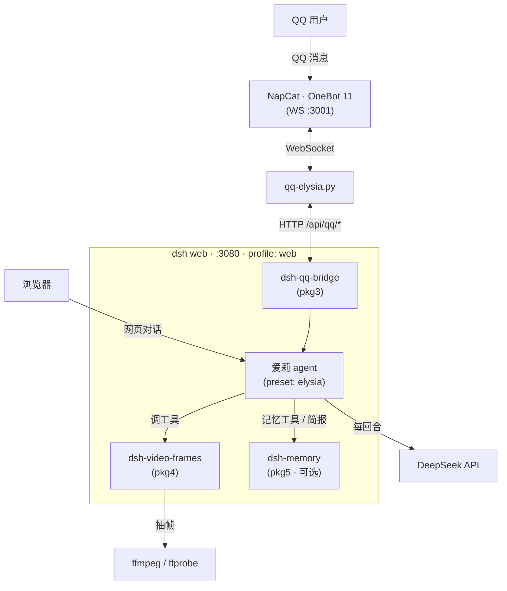

# Elysia-DSH-Pack

> 把 [DeepSeek Harness](https://github.com/deepseek-ai/deepseek-harness) 变成爱莉希雅 ——
> 人格 + QQ 接入打包成一键安装，给不想碰命令行的人用。

装完之后，爱莉在浏览器（`http://127.0.0.1:3080`）和 QQ 里都能陪你聊天，还能读写文件、跑命令干活。
再装一个（可选的）视频包，网页里的爱莉还能"看"视频。

---

## ⚠️ 来源说明（先看这段）

**这不是原创项目，是从一份在 B 站一带流传的整合包魔改来的。**

那份包把「dsh 本体 + 爱莉希雅人格 + QQ 接入」打包成小白一键安装版，在网上流传。
**再往上的最初作者已经查不到了** —— 所以这里**不标注任何具体作者名**，免得张冠李戴
（把转载者说成原作者，同样是一种失实）。想找原始版本，B 站站内搜「**DeepSeek 爱莉希雅 整合包**」试试。

本仓库只对**自己改动的部分**负责，而改动其实不小：适配新版 dsh、重写 QQ 桥、新增视频包……
现在这份跟原包**已经差别很大了**（详见下面「这个改版改了什么」）。

**如果你是原作者，或知道上游是谁 —— 欢迎开 Issue 联系**，署名怎么算都可以谈。

**本仓库不包含的东西：**

- **声线素材（20 条 `g-01~20.wav`）** —— 那是《崩坏3》爱莉希雅的配音片段，版权不属于本项目，
  不便二次分发。需要的话请到原包处获取，放进 `voice-clips/` 即可被脚本识别。
  （`.gitignore` 已经把 `*.wav` 挡在外面了。）
- **dsh 本体** —— 由包1 安装脚本从 npm 现装，本仓库不含也不分发。
- **CosyVoice 语音引擎**（约 3GB）—— 需要自己下载，见包2 的 `mods/persona/docs/voice-guide.md`。

---

## 装什么

五个包，包1 是核心，其余每包一个可选 mod：

| 包 | 作用 | 必须？ |
|---|---|---|
| **`elysia-pkg1-core.zip`** | 装 Node.js → `npm install -g @deepseek-ai/dsh@0.1.6-alpha.2` → 收 API Key → 后台起 `dsh web` → 生成桌面启动器 | ✅ 必须 |
| **`elysia-pkg2-persona.zip`** | 装爱莉人格预设，设为默认 | 推荐 |
| **`elysia-pkg3-qq.zip`** | 接 QQ（NapCat 自动下载，钉版本 + sha256 校验） | 可选 |
| **`elysia-pkg4-video.zip`** | 视频理解：内容总结 / 抽帧 / 场景检测 / GIF / 元数据（需自备 [ffmpeg](https://www.gyan.dev/ffmpeg/builds/)，脚本会检查并给指引） | 可选 |
| **`elysia-pkg5-memory.zip`** | 独立长期记忆 bundle：事实、候选线索、简报、手动整理；不依赖人格包 | 可选 |

### 安装

1. 解压 `packages/` 里的 **`elysia-pkg1-core.zip`**，双击里面的 `install.bat`
2. （推荐）同理解压并双击 `elysia-pkg2-persona.zip`
3. （可选）同理解压 `elysia-pkg3-qq.zip` 并双击——需要先自己下载 NapCat
4. （可选）同理解压 `elysia-pkg4-video.zip` 并双击——机器上最好先装好 ffmpeg，
   没装脚本也会停下来给指引（推荐 `winget install Gyan.FFmpeg`）
5. （可选）同理解压 `elysia-pkg5-memory.zip` 并双击——已有 `dsh-memory` 会跳过；装完重启 dsh

每个包里都有一份 `README.md` 写详细步骤。

---

## 版本：装哪个

当前源码提供五包 mod 布局、QQ 会话映射与续场、独立记忆包，尚未创建对应 Release。
从源码下载 `packages/` 可取得本版五包；下面的 v2/v1 链接保留为历史版本，仍使用各自发布时的包名与布局。

| Release | 内部实现 | 适合谁 |
|---|---|---|
| **当前源码 · Mod 整合版（未发布）** | 每包一个 mod；QQ 私聊与各群分会话、持久映射与 resume；独立 dsh-memory 0.2.4 | 接受本轮 C/D/E 待验收状态的用户 |
| **[v2.0.0 · 第二阶段插件化](https://github.com/Kagurazaka135/Elysia-DSH-Pack/releases/tag/v2.0.0)** | 回复由模型调 `qq_reply` 工具提交；每个 QQ 用户挂工具闸门；回复游标是毫秒时间戳 | 使用已发布版本 |
| **[v1.0.0 · 第一阶段稳定版](https://github.com/Kagurazaka135/Elysia-DSH-Pack/releases/tag/v1.0.0)** | 回复靠 `session/event` 旁听回合、取最后一段文本；进程内计数游标；无工具闸门 | 已经在用、不想动，或 v2 出问题想退回 |

一句话：**v1 是「桥在旁听」，v2 是「模型主动交稿」。**

v1 有个已修的老毛病：`dsh web` 一重启，进程内的回复计数从 0 开始，但分身存盘的游标只增不减
→ 游标永久跑赢新回复 → **新回复静默丢失**，得手动删 `reply-cursor.json` 才能恢复。
v2 用毫秒时间戳当 id，重启后接着往上走，不丢也不重发。

**升级/降级都是覆盖安装包3，但 `qq-elysia.py` 和 dsh 插件必须一起换：**

- 新插件 + 旧 Python：安全（新插件保留了 `seq` 字段兼容旧分身）
- 旧插件 + 新 Python：**不安全** —— 旧插件只给 `seq`，新 Python 读 `id`，游标不前进，
  同一条回复每 2 秒重发一次

正常用安装包不会踩到（两端一起装），但手工替换文件时要留意。

---

## 架构一览

一张图看懂装完之后各部件怎么连（`dsh web` 是内核，五个包往它上面叠）：



- **浏览器面**：直接和爱莉对话，能读写文件、跑命令（内核自带的能力）。
- **QQ 面**（pkg3）：QQ 消息经 NapCat 转成 OneBot 协议 → `qq-elysia.py` 转发进 `dsh web` → 爱莉的回复再原路发回 QQ。
- **视频线**（pkg4）：爱莉调 `video_analyze` → `ffmpeg` 抽关键帧 → 喂视觉模型 → 返回画面描述。
- **大脑**：所有回合最终都打到 DeepSeek API（装了 pkg4 时，总结画面用的是支持图像的 `deepseek-flash`）。

**五个包分别叠在哪：**

```
web profile 的 bundle 栈（从上到下即加载顺序）：

  dsh-base                ← dsh 内核自带
  dsh-web-app             ← 网页界面，dsh 自带
  dsh-qq-bridge           ← pkg3 装的
  dsh-video-frames        ← pkg4 装的
  dsh-memory              ← pkg5 装的（独立 bundle）
  profiles/web/cordis.patch.yml   ← 覆盖层（安装脚本写 agentPreset / cwd 等）

pkg1 = 把 dsh 本体 + web profile 装上、收 API Key、起服务
pkg2 = 往 ~/.dsh/.agent-presets/ 塞「爱莉」人格预设，并设为默认
```

---

## 这个改版改了什么

### 总纲：从「在旁边补 Python」改成「长在 dsh 里」

一句话概括这版的方向：**能交给 dsh 插件机制做的，都搬进插件了。**

| | 早期做法（= v1.0.0） | 现在（= v2.0.0） |
|---|---|---|
| QQ 回复怎么产生 | Python 分身**旁听** dsh 的事件流，抓回合最后一段文本 | 模型主动调 **`qq_reply` 工具**交稿；旁听降级为兜底 |
| 谁能用哪些工具 | 没有这一层（只有"这个 QQ 号能不能用"的准入） | 每个用户的 agent 单独挂**工具闸门**，在调用点拦截 |
| 人格挂不上怎么办 | 桥跟着崩，或裸跑 → 模型吐工具语法 | 降级链 `elysia` → `standard` → 无工具（告警） |
| 回复序号 | 进程内计数器 + 分身存盘游标 | 毫秒时间戳，跨进程重启连续 |
| 配置怎么写 | 脚本按字符串硬改 `settings.yaml` | 只做**精确单行标量替换**，遇到块值 / 含 `#` / 重复键就跳过并提示 |

这么改的意义不只是"干净"：**权限和回复都发生在 dsh 的调用点上**，
Python 侧只能挡住"QQ 这一条路"，而闸门挡住的是**所有路径**。

v1.0.0、v2.0.0 是历史快照，留着兜底用；当前源码在 v2 基础上继续做 mod 化与记忆补齐。

### 包1 · 核心包

- **钉死版本号**：原脚本写的是 `npm install -g @deepseek-ai/dsh`（不带版本），
  而 npm 的 `latest` 标签当时指向的是 `0.1.5-rc.3`，**不是**最新版。改成显式安装 `0.1.6-alpha.2`。
- **补装 pnpm**：`dsh plugin add` 内部转发给 pnpm，机器上没有 pnpm 会直接失败（exit 127）。

### 包2 · 人格包

预设 `preset/agent.cordis.yml` 三处，适配 0.1.6 的配置键变化：

```diff
-    text: |-
+    prefix: |-

-    - id: workflow-worker-thread
-      name: '@deepseek-ai/dsh-workflow-worker-thread'
+    - id: workflow-ptc
+      name: '@deepseek-ai/dsh-workflow-ptc'

     - id: tool-ralph
       name: '@deepseek-ai/dsh-tool-ralph'
+      disabled: true
```

上面那个 workflow 改名有个坑，装到**非 0.1.6** 的机器上就会踩：

- 预设按 0.1.6 写 `@deepseek-ai/dsh-workflow-ptc`，而 **0.1.5.x 只有
  `@deepseek-ai/dsh-workflow-worker-thread`**。名字解析不到时，DSH 的预设体检会把
  整个预设判成 **broken**，界面上就是一张红标签卡片「**加载失败**」——
  点都点不进去，也不告诉你为什么。
- 安装脚本现在会**按本机实际装着的包换名**（有 ptc 用 ptc，只有 worker-thread 就换回去），
  并**逐行自检**预设引用的插件是否都在本机，缺了直接列出来。

另外修了默认预设那一段：旧脚本看到 `settings.yaml` 里已经有 `agent-presets` 键就整段跳过
（Web 设置页早就写过这个键），于是默认值永远停在 `standard` —— 现在按段定位、只改
`default` 的值，并留一份 `settings.yaml.bak-pkg2` 备份。

### 包3 · QQ 包（改动最大）

原版插件是个 `cordis_define` 代码片段，靠用户**手动往会话里贴**。0.1.6 没这个工具了，所以整个重写：

| 项 | 原版 | 本版 |
|---|---|---|
| 装载方式 | 会话里贴代码片段 | 标准 bundle 插件，`dsh plugin add` 自动装 |
| 路由 `kind` | `'json'`（**非法值**，静默落进 prefix 表） | `'exact'` |
| 请求体读取 | 无上限 | 有界读取 |
| agent 归属 | 所有 QQ 用户**共用一条会话** | 每个用户的私聊、各群各自一个 agent，上下文隔离 |
| 鉴权 | 无 | 支持共享 token，安装时生成；白名单/口令**单源** `D:\AI\JARVIS\qq-config.json`（插件每次注入都重读，改完重启分身即生效，dsh 不用动） |
| WS 鉴权 | `onebot11.json` 的 token 留空 | 安装时生成 token，分身连接带 Bearer 头 |
| 发送者白名单 | 无，谁发都回 | 安装时必填；非白名单直接拦截（分身 fail-closed，插件同源同语义双保险） |
| 回复通道 | 模型写 `reply.json` 文件，脚本轮询 | 模型调 **`qq_reply` 工具**主动交稿；`session/event` 只作兜底（模型忘调工具时取回合最后一段文本） |
| 回复游标 | 进程内计数，dsh 重启后**永久跑赢**新回复 → 静默丢 | 毫秒时间戳 id，重启后接着往上走；分身存盘游标（原子写） |
| 工具权限 | 无 | 每个 QQ 用户的 agent 可按 `blockedTools` 挂**工具闸门**，在调用点拦截，绕不过 |
| 看图 | 不支持（"没长眼睛"） | QQ 图片落盘 → `attachments` 服务转 image block 真实进模型（白名单+数量/大小上限+400px 压缩；见下面「看图」小节） |

顺带修了几个会让整条链路挂掉的问题：

- **人格包没装时，QQ 桥会整个崩掉** —— 预设挂载失败会连带回滚 agent 创建。现在走降级链：
  `elysia` → 内置 `standard` → 无工具模式（并告警）。人格包是可选的。
- **没挂上预设时模型会裸吐工具语法**（`<｜｜DSML｜｜ calls>`）—— 因为系统提示仍是「你是个 coding agent」，
  但一个工具都没有。降级到 `standard` 之后就有工具了，正常说话。
- **NapCat 原来只给链接让用户自己下** —— 安装脚本现在自动拉 **钉死版本** 的 release zip 并做 sha256 校验，失败/校验不过转手动指引。

### 包3 · 看图（feat/看图与填坑 这轮接回来的）

- **链路**：`qq-elysia.py` 收到图片段 → 只从 **QQ 官方 CDN 白名单**（`multimedia.nt.qq.com.cn` / `gchat.qpic.cn` / `qq.com`）下载（≤3 张、单张 ≤5MB、ffmpeg 压到 400px）→ 路径随注入 body 的 `images` 字段交给插件 → 插件读文件、按**魔数**认格式（PNG 内容顶着 .jpg 名也能认对）、经 dsh `attachments` 服务落盘成 image block → 和文本一起 `followup` 进 agent。纯图消息（只有图没字）照常转发。
- **⚠️ 前提是模型支持视觉（硬门）**：dsh 的 deepseek-official 目录里只有 `deepseek-flash` 声明了 `inputModalities: [text, image]`；**目录外的模型 id 一律按纯文本路由**——给纯文本模型发图，图会被投影成占位文本或在请求时被 dsh 直接拒掉，怎么调都"看不见图"。所以包1 的默认模型已从 `deepseek-v4-flash`（目录外=纯文本）换成 **`deepseek-flash`**。插件还会在注入带图消息前用 `ctx.llm.listModels()` 查一次目录：能确定当前默认模型不支持图片时，就不发图块、改成在消息里如实备注"当前模型不支持看图"（判定按 provider/model 缓存）。**不硬编码视觉模型 id**——上游模型目录变了会自动跟随/如实降级，而不是静默失效。
- **改白名单不再两处跑**（A1）：以前插件读 profile 里的副本、分身读 `qq-config.json`，改了后者插件永远不跟（新号 403、换 token 401）。现在插件以 `qq-config.json` 为唯一真源（按 mtime 缓存直读），且 401（口令不对）和 403（白名单外）状态码分开，分身按码回不同话术。
- ** NapCat 钉版本 + hash**（D6）：不再拉 `latest`，钉 `v4.18.28` + 该资产的 sha256（下载失败与校验不符分开报，坏包绝不解压）；包1 的 Node.js 安装包也改为**一律对 nodejs.org 官方 SHASUMS256 校验**（镜像自带的 SHASUMS 是同源自证，挡不住镜像被投毒）。
- **websockets 兼容**（A4）：分身连 NapCat 的头参数名按 `websockets.connect.__module__` 特征选（v14+ `additional_headers` / v13- `extra_headers`），认错时重连自动翻面；安装脚本会 `pip install websockets>=14`。⚠️ 交接单原建议的 `hasattr(websockets,'asyncio')` 判据在 v15 上实测不成立（包属性 lazy_import，未触发解析前是 False）。
- **token 生成改 CSPRNG**（D1）：`Get-Random` 是时间种子可被离线枚举复现，改 `RandomNumberGenerator::GetBytes`。
- NapCat 启动从管理员降为普通权限（D9）；`onebot11.json` 重建前先备份（A3）、改走 `ConvertTo-Json`（D10）；白名单输入全非数字时重问（A7）。

### 包4 · 视频包（本仓库新增）

不是改原包，是**新增**：把独立插件 **dsh-video-frames**（未发布到 npm）打包成第 4 个安装包，
给纯文本的爱莉补上视频理解——抽帧 / 场景检测 / GIF / 元数据 / 视觉模型总结画面。

- **真机实测通过（5/5 工具）**：`video_analyze` 抽帧 → 喂视觉模型 → 返回**真实画面描述**
  （不是"看不到图"那种降级回复），其余四个工具逐一出真实产物（元数据 / 帧 / 切点 / GIF）。
- 安装脚本照包3 的路子（复制 → `npm install` → `dsh plugin add`），
  外加 **ffmpeg / ffprobe 的检查与指引**：只提示不自动装；还会识别 **2013 年那种能跑、但解不动手机 HEVC 的上古版本**。
- **只在网页面可用**——QQ 桥不支持传视频。

---

## 已知限制

- **本轮验收边界**：只做 A/B 层静态、打包、代码审读与模拟检查。C 真 dsh 加载、D Windows 安装器、E QQ/模型端到端均未实跑：环境不具备，交回维护者。下列 v2 历史测试不代表本轮已通过 C/D/E。
- **会话续场**：映射默认保存在工作目录的 `tasks/qq-sessions.json`，可用 `sessionStorePath` 指定；续场依赖可选 `sessionPersistence` 服务。失败会告警、换新 ID，映射不随插件卸载删除。升级前没有映射的旧会话不会自动接续。
- **群聊记忆**：强制拒绝 `memory_*` 调用，但名称仍可能出现在工具清单中。共享简报仍可能自动注入群聊，其他文件工具也可能读取记忆目录，因此这不是完整的记忆隔离；本轮按指定 guard 实现，E5“工具清单不可见”未满足。
- **自动整理**：记忆插件的定时整理需要 `schedule` 服务；本包钉住的 web profile 没有该服务，仅支持按需手动整理，不额外安装定时服务。
- **人格预设兼容性**：宿主记忆工具对 `elysia` preset 的可见性及实际读写效果待维护者验收。
- **图片（QQ 面）**：链路已通，但**默认模型必须支持视觉**才真看得见——包1 新装默认
  `deepseek-flash`（dsh 目录里声明的文本+图像模型）。已装过的老环境若默认还是
  `deepseek-v4-flash`（不在 dsh 目录里 = 纯文本路由），QQ 发图只会得到"看不了图"
  的如实回复，去 dsh Web 设置页把默认模型换成支持视觉的即可。插件会查模型目录并
  在不支持时降级为纯文本+备注，不会白跑。
- **视频**：装了包4 才有，且**只在网页面**可用（QQ 桥不支持传视频）；机器上需要有 `ffmpeg` 在 PATH
  （**太老的版本解不动手机拍的 HEVC**，建议从 [gyan.dev](https://www.gyan.dev/ffmpeg/builds/) 装新版）。
- **语音**：需要额外装 CosyVoice（约 3GB）+ ffmpeg。没装时**文字照发**，只是没有语音条。
- **API Key 是明文**存在 `~/.dsh/.credentials.yaml`（dsh 上游的设计），别把这台机器上的这个文件发给别人。
- **只在 v0.1.6-alpha.2 上测过**，其他版本没验证。
- 验证口径：**包3（QQ 桥）已真机端到端跑通**——两台真 NapCat（bot 挂 WS、
  发送方挂 HTTP）→ `qq-elysia.py` → 真 `dsh web` → 爱莉 agent → 回复回 QQ：**文字**（私聊
  收发）与**看图**（QQ 发图、模型原样读出图内文字与配色）均实测通过；全程走本地凭证代理、
  **零真 key**。包1/2 的安装脚本仍在**模拟环境**（全新 DSH_HOME）验证；包4 在**真 `dsh web`**
  上加载无报错、5 个工具逐一出真实产物。
- **v2.0.0 额外验过**：`qq_reply`（会话日志里确有 `tool/call`）、工具闸门（`pwsh` 被拒后
  agent 正常回话）、消息去重、**dsh 重启后游标恢复**（新回复送达、老回复不重发）、
  预设缺失降级 `standard`（27 个工具、无 DSML）。
- **群聊 @ 响应未验**：测试用 bot 不在任何群。代码路径与私聊共用同一套白名单与去重逻辑，
  但"群里不 @ 就不理"这条**没有实机证据**。
- 看图链路（feat/看图与填坑）：Python 侧（白名单/压缩/上限/转发）与插件侧（图块转换/
  能力预检/单源鉴权）各有一套 mock 实测（本地 mock CDN + mock dsh ctx，30+27 项断言全过）；
  模型能力结论对**实测安装的 dsh 0.1.6-alpha.2** 核过（`deepseek-flash` = text+image，
  目录外 id = 纯文本路由）。真机验收见上一条。

---

## 目录结构

```
packages/            # 五个安装包（解压双击 install.bat 即可）
mods/                # 唯一功能源码：persona/、qq/、memory/、video/
src/                 # 仅安装器：install.bat + setup.ps1 + README.md
├── pkg1-core/
├── pkg2-persona/
├── pkg3-qq/
├── pkg4-video/
└── pkg5-memory/
```

`src/` 里每个包的 `setup.ps1` 是把 `install.bat` 里 base64 打包的 PowerShell **解码后的可读版本** ——
`install.bat` 本身是「提权 + 解码 + 执行」的外壳，逻辑全在 `setup.ps1` 里，想看改了什么直接 diff 这个。

> **改 `setup.ps1` 后必须重打包进 `install.bat`，否则装的时候跑的还是旧逻辑。**
> 直接跑 `python tools/repack.py`（`--check` 只校验不写入）：自动把安装器 `src/` 和功能载荷 `mods/`
> 组装进 `packages/*.zip`，做 round-trip 断言，并把 zip 里的 `install.bat` 统一成 **CRLF**。
> 内嵌载荷的编码约定：把 `setup.ps1` 读成文本 → 去掉已有的 BOM → 换行统一成 **LF** →
> 按 **UTF-8 带 BOM** 编码 → base64 → 每 **100** 字符一行，包在
> `-----BEGIN/END CERTIFICATE-----` 之间，每行前缀 `>>"%B64%" echo `。
> 那个 BOM 不是可选的：解出来的脚本一旦没有 BOM，PowerShell 5.1 就会按系统 ANSI 码页
> 去解码这个 UTF-8 文件，中文全乱，甚至报出根本不存在的语法错误。

---

## 致谢

- 原整合包：B 站上流传的那份魔改包（人格预设、安装脚本、QQ 桥的初版都出自它）
  —— 具体作者不明，见上面「来源说明」
- [DeepSeek Harness](https://github.com/deepseek-ai/deepseek-harness) —— 本体
- [CosyVoice](https://github.com/FunAudioLLM/CosyVoice) —— 语音合成
- [NapCat](https://github.com/NapNeko/NapCatQQ) —— QQ 协议
- 爱莉希雅 © 米哈游 —— 角色与配音素材版权归米哈游所有，本项目仅为非商业的同人爱好用途
